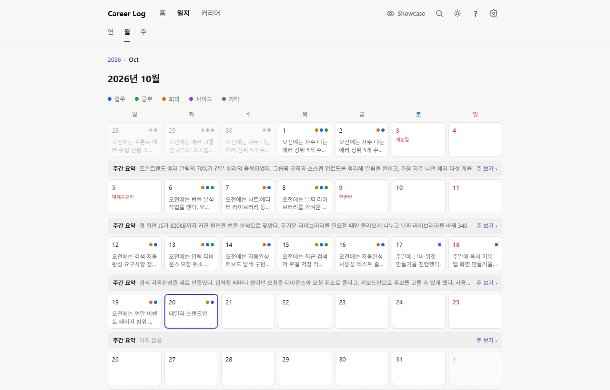
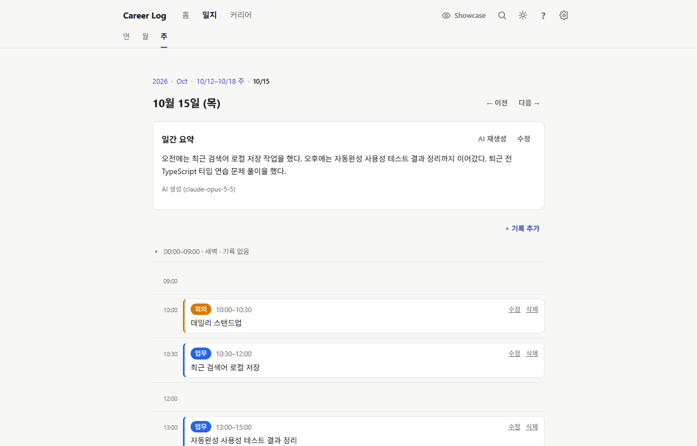
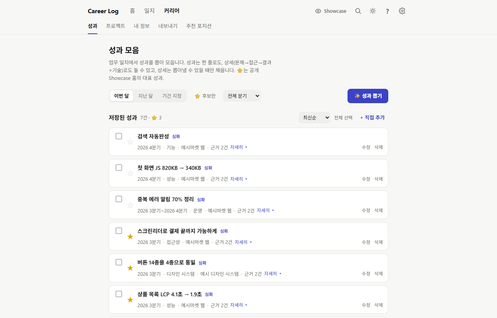
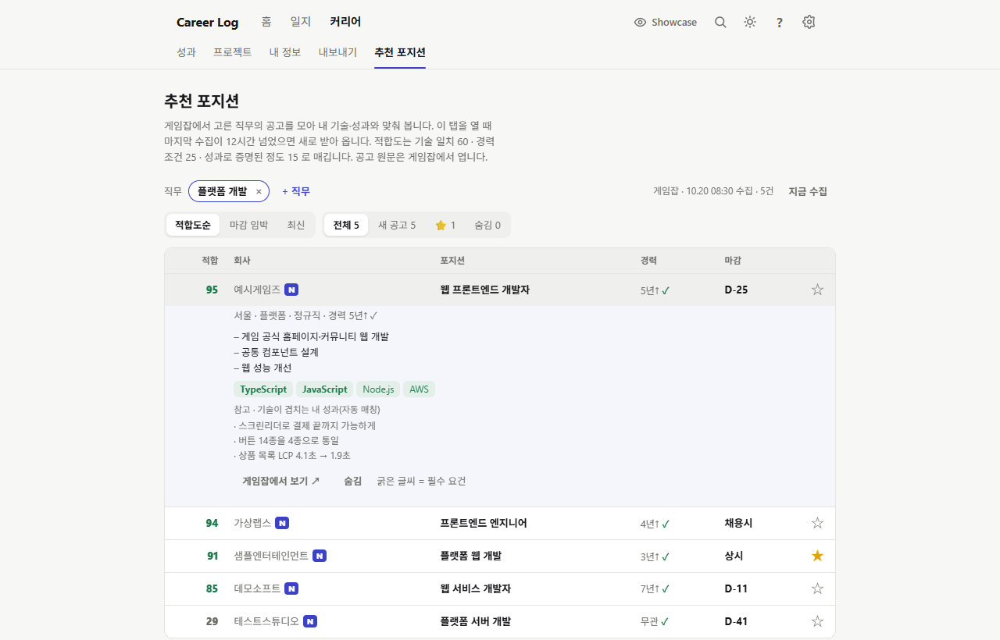
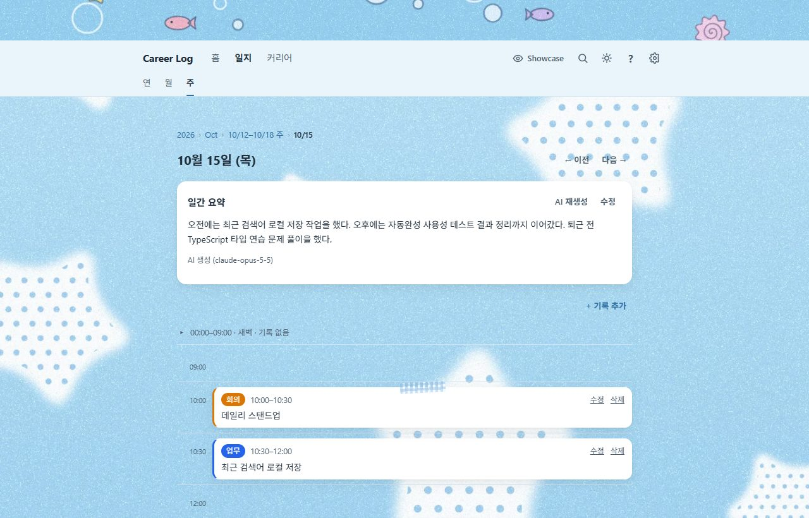

# Career Log

**1인용 업무 일지 서버.** 홈서버에 띄워서 쓴다. 비밀번호를 걸어 **본인만 접근하는 private 서버**로, 기록이 남에게 보이지 않는다.

하루에 한 일을 **1시간 단위로 기록**하고, 하루가 끝나면 그날을, 한 주가 끝나면 그 주를, 한 달이 끝나면 그 달을 **요약해서 쌓는다.**

- **일지**: 연·월·주 달력에 주간 요약이 항상 보이고, 일 셀을 누르면 그날의 **시간 단위 기록 전체**를 보고 고칠 수 있다.
- **요약**: 하루·한 주·한 달이 끝나면 AI(Claude)가 요약 초안을 쓴다. 키가 없으면 직접 쓴다.
- **알림**: 매 정시 푸시 알림을 누르면 그 시간대 입력 폼으로 바로 들어간다(PWA).
- **검색**: 전체 기간을 한국어 부분일치로 찾는다.
- **커리어**: 쌓인 기록에서 **성과를 뽑아 모으고**, 프로젝트·내 정보와 묶어 **포트폴리오로 내보낸다**(인쇄·PDF). 게임잡 공고를 모아 내 기술·성과와의 **적합도**를 보여준다.
- **Showcase**: 숨기지 않은 성과·프로젝트를 로그인 없이 보는 **공개 포트폴리오 페이지**. 일지·요약·설정은 절대 노출되지 않는다.
- **테마**: 기본 테마 7종(수채 다이어리·하늘 별·도자기 참·모던·필름·숲·밤하늘) 또는 색·모양·바탕 이미지를 바꾼 내 테마.

## 화면



| | |
|---|---|
| <br>**하루 — 시간 단위 기록과 AI 일간 요약** | <br>**커리어 — 기록에서 뽑아 모은 성과** |
| <br>**추천 포지션 — 공고와 내 기술·성과 맞춰 보기** | <br>**테마 — 기본 테마 7종과 내 테마** |

**[전체 화면 보기 →](docs/SCREENS.md)** 연·주 보기, 검색, 프로젝트, 포트폴리오 내보내기, 공개 Showcase, 설정, 테마 7종, 다크 모드, 모바일

> 캡처의 인물·회사·기록은 모두 지어낸 예시 데이터다.

## 상태

| 단계 | 상태 |
|---|---|
| 1단계 — 기록 | ✅ 기록 CRUD · 달력 · 검색 · 일/주/월 요약 · 정시 알림 · 시점 복원 |
| 2단계 — 커리어 | ✅ 성과 모음 · 추천 포지션 · 공개 Showcase |
| 3단계 — 문서 자동 작성 | 🚧 포트폴리오 조립·인쇄 · 저장본 ✅ / 경력기술서(양식 대기) · AI 다듬기 + 근거 역추적 · 채용공고 맞춤 남음 |
| 공통 — 테마 | ✅ 팔레트 · 모양 · 이미지 · 기본 테마 7종 · 내 테마 |

→ [로드맵](docs/ROADMAP.md)

> 이 프로젝트는 바이브 코딩 위주로 구현합니다.

## 문서

| | |
|---|---|
| [화면 모음](docs/SCREENS.md) | 전체 화면 캡처(예시 데이터) |
| [기획서](docs/PLAN.md) | 무엇을 왜 만드는가, 기능 명세, 화면 |
| [아키텍처](docs/ARCHITECTURE.md) | 시스템 구성, 기술 스택, 저장 계층, 배포, 장애 동작 |
| [데이터 모델](docs/DATA-MODEL.md) | 저장 레이아웃, 스키마, API, 코드 규약 |
| [설계 결정](docs/DECISIONS.md) | ADR — 무엇을 포기했고 언제 뒤집는가 |
| [로드맵](docs/ROADMAP.md) | 단계별 범위 |
| [CLAUDE.md](CLAUDE.md) | Claude Code 작업 규칙 |

## 한눈에 보는 구조

```
브라우저/PWA ──HTTPS──> 리버스 프록시 ──> career-log 컨테이너
                                                    │
                                      ┌─────────────┴─────────────┐
                                      ▼                           ▼
                             private GitHub 레포           Claude API
                             (기록의 정본)                 (요약 생성)
```

- 기록의 정본은 **원격 private GitHub 레포**. 홈서버에 과거 기록을 보관하지 않는다.
- 로컬에 남는 것은 **미동기화 쓰기 큐**(평상시 0바이트)뿐.
- 캐시는 프로세스 메모리 LRU. 별도 DB도 캐시 서버도 없다.

## 시작하기

### 로컬 개발

```bash
npm ci
npm run gen:password     # 출력된 AUTH_PASSWORD_HASH 를 .env 에
npm run gen:secret       # 출력된 SESSION_SECRET 을 .env 에
cp .env.example .env     # 위 두 값만 채우면 일단 뜬다
npm run dev
```

나머지 환경변수는 해당 기능을 구현할 때 채우면 된다. 비어 있으면 그 기능만 비활성되고 앱은 뜬다.

### 서버 배포

서버에는 Docker만 있으면 된다. Node·npm·빌드 툴체인은 필요 없다.
소스를 clone하는 것은 `docker-compose.yml`과 `.env`를 두기 위해서일 뿐,
실행은 레지스트리에서 받은 이미지로 한다(빌드 아님).

```bash
git clone <이 레포>
cd career-log
cp .env.example .env     # 아래 "비밀값은 개발 머신에서" 참고
docker compose pull      # 이미지 받기
docker compose up -d     # 실행
```

이미지는 **서버에서 빌드하지 않는다.** 개발 머신이나 CI에서 빌드해 레지스트리에 올린 뒤 pull한다. ([근거](docs/DECISIONS.md))
서버가 ARM(라즈베리파이 등)이면 이미지도 그 아키텍처로 빌드해야 한다:
`docker buildx build --platform linux/arm64 -t <이미지> --push .`

#### 비밀값은 개발 머신에서 만든다

`AUTH_PASSWORD_HASH`와 `SESSION_SECRET`은 **개발 머신에서** 생성해 서버 `.env`에 복붙한다.
둘 다 단순 문자열이라 어느 머신에서 만들든 동일하게 동작하며, 생성기(`npm run gen:*`)는
개발 머신 전용이다. 서버에 npm을 깔지 않기 위한 의도적인 분리다.

```bash
# 개발 머신에서
npm run gen:password     # → AUTH_PASSWORD_HASH=...
npm run gen:secret       # → SESSION_SECRET=...
```

### 필요한 것

- Linux + Docker Compose가 도는 홈서버
- 데이터 전용 **private GitHub 레포** + contents 읽기/쓰기 권한 PAT
- HTTPS를 종단하는 리버스 프록시 (알림이 보안 컨텍스트를 요구하므로 HTTPS 필수)
- (선택) Anthropic API 키 — 없으면 요약은 수동 작성으로 폴백

### 다음

남은 것은 3단계다. 사용자 양식대로 조립하는 **경력기술서**, 문단마다 근거 성과로 되돌아가는 **AI 다듬기**, **채용공고 맞춤**. 목표는 이력서 초안이 기억이 아니라 기록에서 나오는 것이다. → [로드맵 3단계](docs/ROADMAP.md)

## 라이선스

[MIT](LICENSE)
